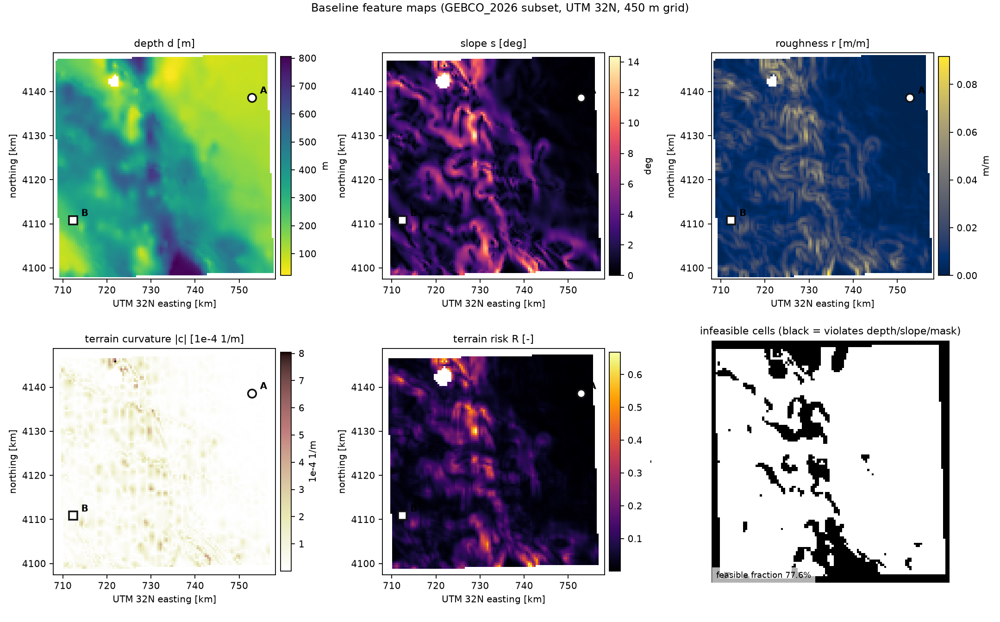
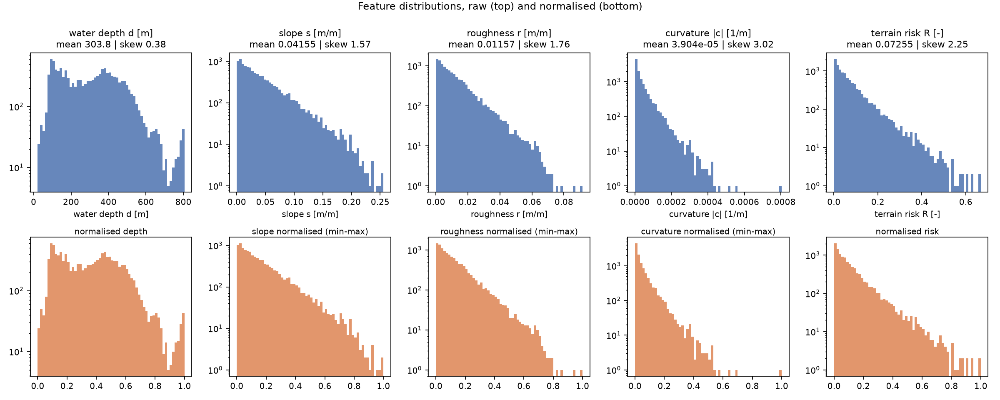
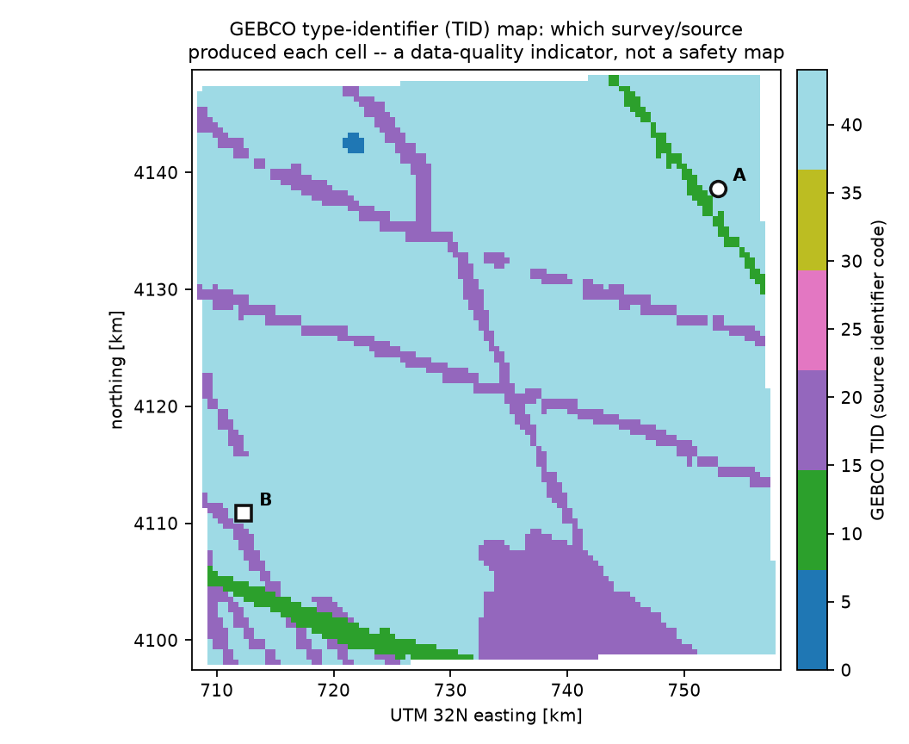
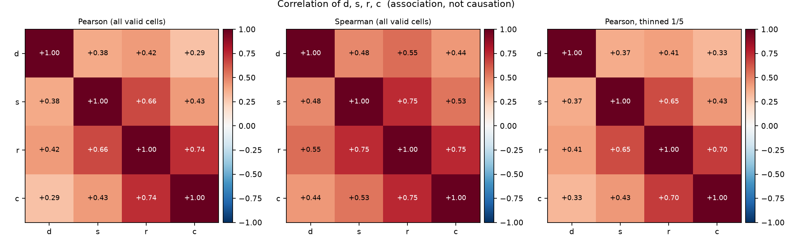
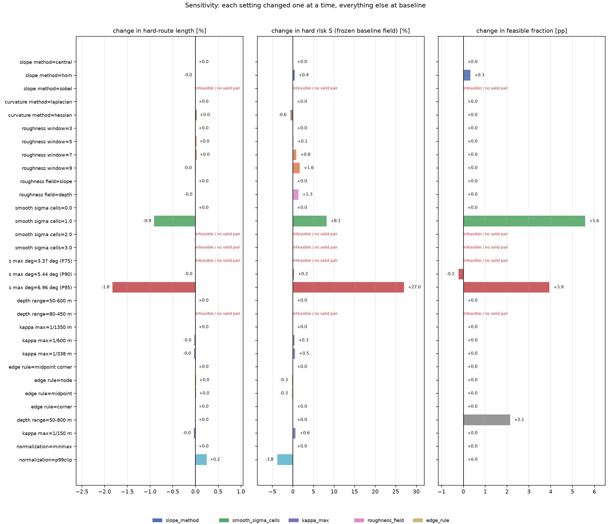
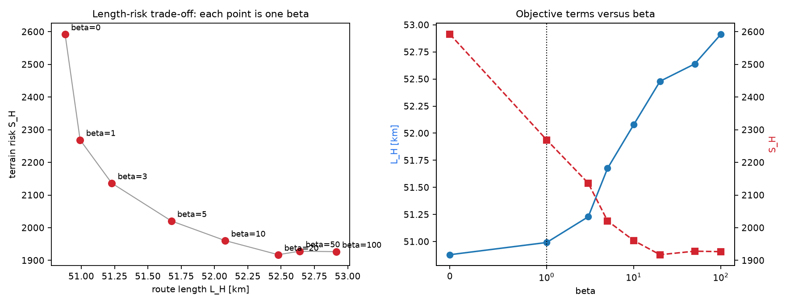
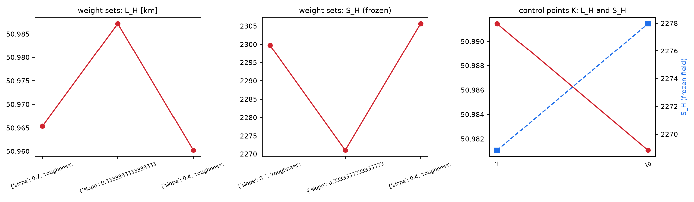
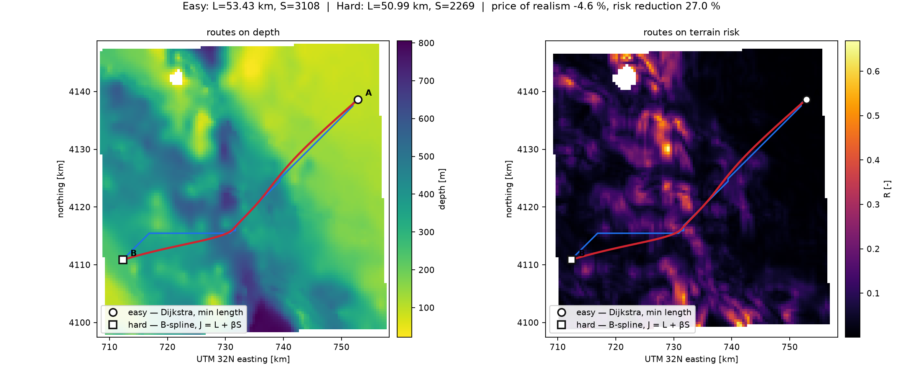
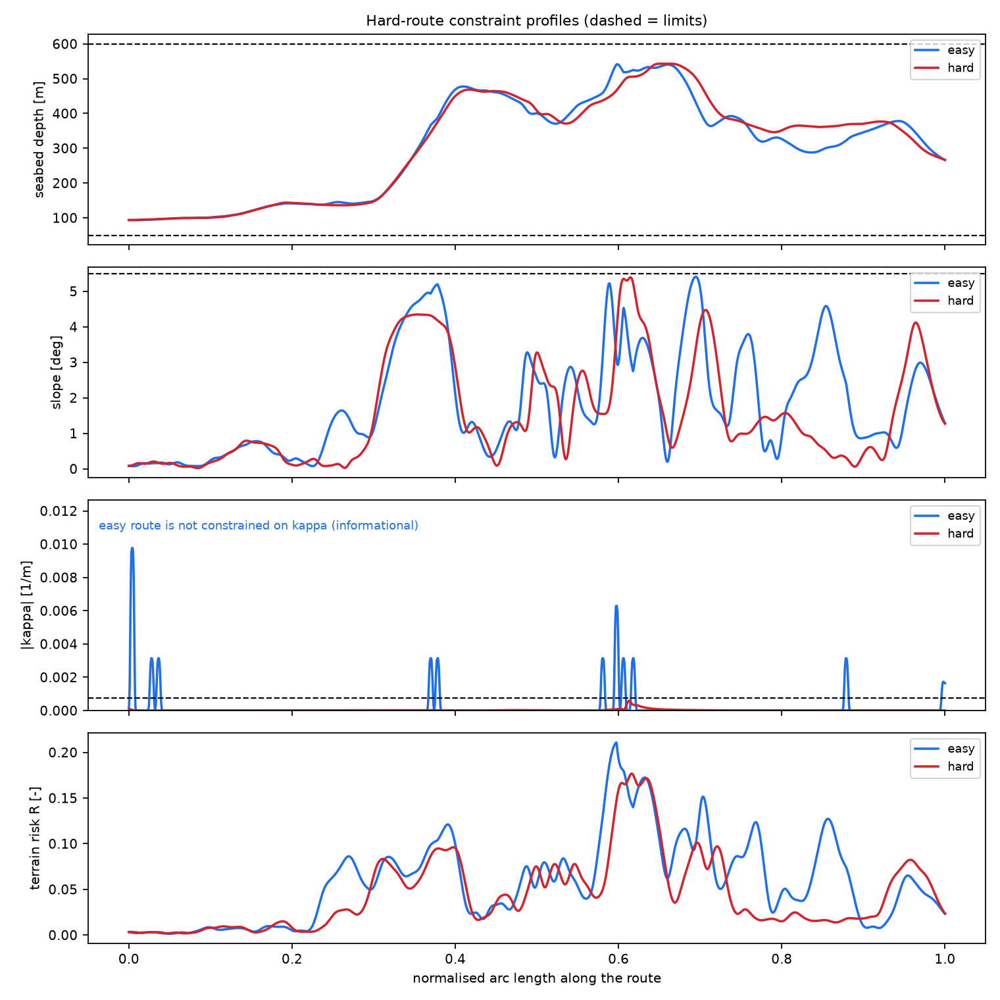
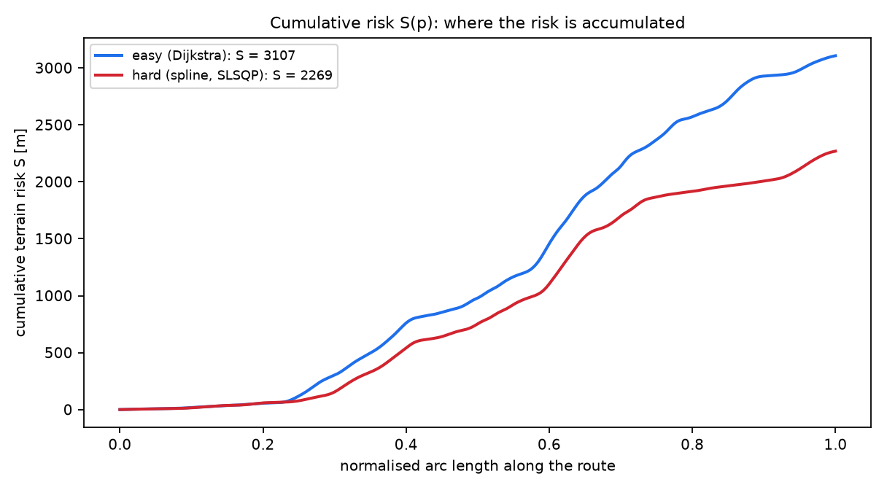

# Underwater Tunnel Route Optimization
### A length–risk trade-off study on GEBCO_2026 bathymetry (Sicily Channel, 15 arc-sec)

*Report generated by `python -m src.report` from `results/*.json|csv`.
Every number below is produced by code in `src/`; nothing is transcribed by hand.*

**One-paragraph summary.** Two formulations are solved on the same 115 × 113 bathymetric
grid, with the same mask, the same data-derived risk field R(x,y) and — for the *reported*
L, S and J only — the same post-hoc polyline evaluator. The two optimisers are deliberately
different, and integrating a route is never confused with optimising it: the grid route comes from
a graph search, the spline route from a continuous SLSQP refinement, and both are then measured by
the same common polyline evaluator, on their respective sampled geometries.
The **easy problem** is an exact discrete shortest path on an 8-neighbour graph with depth and
slope feasibility: Dijkstra finds the discrete optimum between selected snapped endpoint cells
(173 ms repeated-solve median). Exact A/B connectors
are appended and independently validated; they are not optimized over alternative connector choices.
The **hard problem** is a cubic B-spline corridor (7 interior control points, 14 decision
variables) minimising J = α·L + β·S subject to depth, slope and *route-curvature* constraints,
solved by SLSQP from 11 distinct initial curves
(14 solver executions: 11 direct and
3 quadratic-penalty continuations). The adopted point is a
**feasible local candidate** — 2 of those executions reached feasibility, and
they agree to 1 m of J — not a proven global optimum. Relative to the complete connector-inclusive grid route it changes length by
**-4.57 %** (it is shorter, not longer) and lowers cumulative terrain
risk by **26.99 %**, and unlike the grid route it respects a
1350 m minimum turning radius.

---

## 1. Introduction and motivation

A tunnel between two fixed points has to be *routed*, not just measured. Two questions are
usually conflated and are kept separate here:

1. **What is the shortest path between selected snapped endpoint cells?** — a shortest-path problem on a grid, followed by validated exact-endpoint connectors.
   It has an exact, global answer and no notion of smoothness.
2. **What does a *terrain-aware, constraint-compliant* corridor cost?** — a continuous
   optimisation problem with
   engineering constraints (maximum slope, minimum turning radius) and a risk penalty.

The easy problem answers (1); the hard problem answers (2). Comparing them answers the
question a project actually asks: **how much length do we pay for a route that respects a
turning radius, and how much terrain risk do we buy with it?**

Scope decisions fixed before any run (all recorded in `config.yaml`):

* One risk field R(x,y) = w_s·s̃² + w_r·r̃ + w_c·c̃, weights **0.5/0.3/0.2**,
  min–max normalisation over valid cells, no smoothing in the baseline. The weights are
  **modeling assumptions**, sensitivity-tested in Sec. 10.3 — they are not derived from, and are not
  validated by, the correlation analysis of Sec. 6.
* Terrain curvature `c` (Laplacian of elevation) never enters route curvature; route
  curvature κ is never used as a terrain feature. `R(x,y)` is the field, `S(p) = ∫ R ds` is
  the cumulative risk along a route.
* A third formulation was explicitly excluded by scope.

## 2. Data

| Item | Value |
|---|---|
| Product | GEBCO_2026 Grid (15 arc-sec, published 2026) |
| Subset | 37.0–37.45 °N, 11.35–11.9 °E |
| Citation | GEBCO Bathymetric Compilation Group 2026 (2026), The GEBCO_2026 Grid, doi:10.5285/4f68d5c7-45eb-f999-e063-7086abc036fa (full reference in the Appendix) |
| Projection | EPSG:32632 (WGS 84 / UTM zone 32N); all lengths in metres, all coordinates easting/northing in metres |
| Grid | 115 rows × 113 columns, 450 m |
| Extent | x 707.9–758.3 km, y 4097.5–4148.8 km |
| Resampling | elevation: bilinear, TID: nearest |
| NoData policy | z <= -100000.0 or non-finite -> missing; land (z >= 0) masked; both applied to the SOURCE raster before resampling |
| Endpoints | A = 11.8550° E, 37.3600° N (UTM 32N x 752.852 km, y 4138.634 km, cell 92,100); B = 11.3900° E, 37.1200° N (x 712.335 km, y 4110.858 km, cell 30,10) |
| Valid cells | 12,020 of 12,995 (92.50 %) — the rest are never used |
| Masked cells | 975 (7.50 %): 952 outside the source footprint (7.33 %), 0.18 % adjacent to land/NoData |
| A → B straight line | 49.11 km geodesic, 49.12 km through the grid (0.027 % difference) |

The grid is metric (metres) in both axes, so every derivative, distance and curvature below is
computed without degree arithmetic. Derivatives are taken **on the grid as it stands**
(sigma = 0 cells in the baseline), i.e. before any smoothing; the
sigma-smoothing experiments in Sec. 10 re-derive everything after smoothing, which is the only way
the two effects can be separated.

**Resampling, masking and the domain boundary (what the code actually does).** The land and NoData
masks are applied to the *source* raster before any resampling, and the reprojection is a strict
bilinear resample: a target point is accepted only when **every source cell with a non-zero weight
is a valid ocean cell**. A land or NoData sample can therefore never be blended into an ocean
value, and no value is ever extrapolated — the earlier version of this code used
`RegularGridInterpolator(..., fill_value=None)`, which extrapolates silently, and in this subset it produced
952 cells that were used as valid bathymetry although they lie outside the source footprint. The valid footprint is the *cell
extent* of the subset (centres ± half a source cell, i.e. 11.3500–11.9000 °E
× 37.0000–37.4500 °N), not the projected bounding box: projecting a
lat/lon rectangle to UTM 32N gives a curved shape whose bounding box contains corners that lie
outside the data. 952 of 12,995 target cells
(7.33 %) are outside that footprint and are masked; a further
23 cells have a stencil that touches one of the
16 land source cells. Inside the footprint but between the outermost
cell centre and the cell edge the edge cell is replicated — the half-cell border is kept rather
than discarded, and no extrapolation is involved.

**Derivative stencils at the array boundary.** `np.gradient` uses one-sided differences on the
outermost interior rows/columns; those cells are **not** excluded from the statistics or from the
feasible mask, and the report says so rather than claiming an exclusion that is not implemented.
The roughness window is a symmetric w × w box with `mode="nearest"`, so at the array border the
window is filled by replicating the edge cell and no artificial zeros enter the statistic. Land,
NoData and outside-footprint cells hold NaN in z, so no derivative is ever taken across the mask;
before a derivative stencil is evaluated, NaNs are replaced by the nearest valid ocean value
(`distance_transform_edt`) and the result is re-masked afterwards. **Feasibility is always judged
on the original, unfilled arrays** — the nearest-value fill exists only so that a stencil has
something finite to read.

The linear striping visible in the slope map is a known signature of **satellite-altimetry
predicted** bathymetry; it is why the TID (type-identifier) map and the σ-smoothing sensitivity are
part of the analysis. Depth is `d = −z` with z the GEBCO elevation: **d is the sea-floor depth**, so
`d_min`/`d_max` bound how deep the seabed is along the corridor — they are *not* tunnel alignment
depths (Sec. 13).

## 3. Feature definitions

Let z(x,y) be elevation (m, negative below sea level), Δx = Δy = 450 m.

| Feature | Definition | Units |
|---|---|---|
| depth | d = −z | m |
| slope | s = √((∂z/∂x)² + (∂z/∂y)²), central differences (Horn/Sobel in Sec. 10) | rise/run (dimensionless) |
| roughness | r = std{s} over a 3×3 window, edges replicated | rise/run |
| terrain curvature | c = abs(∂²z/∂x² + ∂²z/∂y²), the Laplacian | 1/m |
| normalised | x̃ = (x − min)/(max − min) over valid cells, clipped to [0, 1] | — |
| risk field | R = 0.5·s̃² + 0.3·r̃ + 0.2·c̃ | dimensionless, R ∈ [0, 1] |
| cumulative risk | S(p) = ∫_p R ds  (segment-midpoint rule on the route) | metres |

Normalisation ranges actually used (all cells, this baseline):
slope 0.000–0.256,
roughness 0.0000–0.0916,
curvature 1.25e-09–8.04e-04 1/m.

Because min–max normalisation is recomputed for every configuration, **S is not comparable
across configurations** (only within one). It is a length-like quantity in metres whose scale is
set by each configuration's own tail; the report always says which configuration an S belongs to.
The slope term is squared (`s̃²`) so that the field is dominated by the steepest terrain rather
than by the mean.

**Filling and interpolation.** Land (z ≥ 0) and NoData are removed *before* anything else
happens: they are set to NaN, excluded from the statistics, and never carry a finite value into a
derivative. The hard problem needs a smooth field defined everywhere, so the masked cells are
filled with the value of the **nearest valid ocean cell** (nearest-neighbour fill, no
interpolation across the mask) and only then interpolated with a tensor-product cubic spline.
The unfilled arrays are retained and every feasibility claim is checked on them (Sec. 9), so the
fill can change a *search* field but never a *validation* result.

**Route curvature** (used only as a constraint of the hard problem):
κ = (x′y″ − y′x″) / (x′² + y′²)^1.5 [1/m]; the corresponding minimum turning radius is 1/|κ|.

## 4. Descriptive statistics

| index | unit | count | missing | mean | std | min | p5 | p25 | p50 | p75 | p95 | max | skewness | excess_kurtosis |
|---|---|---|---|---|---|---|---|---|---|---|---|---|---|---|
| d | m | 12020 | 975 | 303.8 | 158.8 | 21.85 | 88.9 | 156.8 | 306.1 | 419.2 | 558 | 805.2 | 0.3805 | -0.4903 |
| s | m/m (rise/run) | 11568 | 1427 | 0.04155 | 0.03912 | 0 | 0.002812 | 0.01221 | 0.02964 | 0.0589 | 0.122 | 0.2558 | 1.565 | 2.733 |
| r | m/m (std of slope) | 12020 | 975 | 0.01157 | 0.01117 | 0 | 0.0007868 | 0.003341 | 0.008303 | 0.01623 | 0.03461 | 0.09165 | 1.764 | 3.93 |
| c | 1/m | 11121 | 1874 | 3.904e-05 | 5.195e-05 | 1.246e-09 | 1.111e-06 | 6.859e-06 | 1.985e-05 | 4.993e-05 | 0.000142 | 0.0008043 | 3.02 | 14.97 |
| R | dimensionless | 11121 | 1874 | 0.07255 | 0.07999 | 0.0009199 | 0.003691 | 0.01753 | 0.04726 | 0.09721 | 0.2349 | 0.6682 | 2.254 | 6.873 |

Counts are cells retained after masking NoData and land
(975–1874 cells lost; 7.50% of the grid for depth).
All five variables are right-skewed: the *tail* is the story — the 95th percentile of R is
0.235 against a maximum of 0.668, so a small number of
steep cells dominate the scale, and avoiding them is exactly what a router does.

## 5. Distributions and spatial maps



*Depth* is a NE–SW graben flank between two shelf areas, 1.6–817 m. *Slope* concentrates on the
flank and on the gravity-derived striping; *roughness* is the same structure smoothed by the
local standard deviation; *terrain curvature* is dominated by a few sharp scarps; *risk* is
sparse — 50 % of cells are below 0.047 while the maximum is 0.668.



The lower row is the same data after min–max normalisation: the shape is unchanged by
construction (it is an affine map), which is why the histograms are shown together — it makes
visible that normalisation cannot fix skewness, only re-scale it. Log-scaled counts.



The TID map shows which survey/source produced each cell. It is a **data-quality indicator,
not a safety map**: where the striping is strongest the TID is the altimetry-predicted class,
and the σ-smoothing sensitivity (Sec. 10) quantifies how much of the risk structure is that
artefact.

## 6. Correlation and spatial autocorrelation



| Quantity | Value |
|---|---|
| Pearson r(s, r) / r(r, c) / r(s, c) | +0.658 / +0.737 / +0.428 |
| Spearman ρ(s, r) / ρ(r, c) / ρ(s, c) | +0.748 / +0.753 / +0.533 |
| Pearson after thinning 1/5 (s, r) / (r, c) | +0.655 / +0.702 |
| Expected I (random pattern) | -0.00009 |
| PCA variance (s̃, r̃, c̃) | 79.3%, 17.0%, 3.7% |

Moran's I is computed for **every** feature, not only for the composite risk field, because a
high I(R) could otherwise come from one feature alone:

| feature | Moran's I (full grid) | thinned 1/2 | thinned 1/3 | cells | unit |
|---|---|---|---|---|---|
| d | 0.9891 | 0.967 | 0.936 | 12,020 | m |
| s | 0.8965 | 0.736 | 0.619 | 11,568 | m/m (rise/run) |
| r | 0.8814 | 0.732 | 0.640 | 12,020 | m/m (std of slope) |
| c | 0.7022 | 0.459 | 0.393 | 11,121 | 1/m |
| R | 0.9175 | 0.784 | 0.687 | 11,121 | dimensionless |

Moran's I is reported with its cell count, its weight scheme (rook, 4-neighbour, binary) and its
behaviour under thinning. **No significance test is claimed**: the usual normal approximation for
Moran's I needs a variance derived for this weight matrix, and that approximation is not valid on a
field this autocorrelated, so no z-score or p-value is quoted. The statistic is used descriptively,
which is all the interpretation below needs.

Every feature is strongly autocorrelated at 450 m (I between
0.70 and 0.99), and every feature keeps most of its structure when the grid is
thinned by 2 and by 3. Depth is the most autocorrelated, as expected for a smooth regional
surface; terrain curvature is the least, because it is dominated by a few scarps. The thinned
runs are a resolution check, not an alternative estimate: they answer "would this statistic
survive a coarser survey?".

*Interpretation.* Slope, roughness and terrain curvature are **strongly associated** — Spearman
is higher than Pearson because the relation is monotone, not linear. Thinning the grid by a factor
of 5 in each direction (that is the factor the code
uses) moves the correlations by less than 0.1, so the association is not an artefact of the 450 m
sampling. Moran's I is ≈ 0.92 on the full grid and
still ≈ 0.69 on a 1/3-thinned grid:
the field is genuinely spatially structured, which is precisely why a *route* can exploit it —
a random field would make routing pointless. The first PCA component of the three normalised
features explains 79% of their variance, i.e. r̃ and c̃
carry largely the same signal as s̃ and the weight vector is not three independent knobs.

Association is not causation, and none of these numbers says anything about geology.

## 7. Easy problem

The easy problem is a **minimum-cost flow / shortest-path problem on a directed graph**. Write
V for the feasible cells, E for the admissible edges, c_ij ≥ 0 for the metric length of an edge
and b for the unit supply at A's selected snapped cell and demand at B's selected snapped cell. The route is the optimal solution of the linear
program

```
minimise    sum_(i,j) in E  c_ij * x_ij
subject to  sum_j x_ij - sum_j x_ji  =  b_i        for every node i in V   (flow conservation)
            x_ij >= 0                                                       (non-negativity)
```

with b_A* = +1, b_B* = −1 and b_i = 0 otherwise, where A* and B* are the selected snapped cells. Because the constraint matrix of a shortest-path
formulation is totally unimodular, the LP optimum is integral and the x_ij are the 0/1 indicator
of a single path — so the LP and the discrete problem have the same answer. Dijkstra solves this
LP without ever forming it: the edge weights are non-negative, so the label-setting algorithm
returns the exact optimum in O(|E| log |V|). That is what makes the easy problem *global*: the
optimum is exact by construction (Dijkstra returns the shortest path of the graph), not found by
search.  

Graph and feasibility definition: nodes = cells; edges = 8-neighbour; an edge exists iff both
endpoints are feasible and, for a diagonal step, the **geometric midpoint of the segment**
(bilinear interpolation of the four surrounding node samples) satisfies the depth and slope
limits and all four surrounding nodes carry valid ocean data — the specification's midpoint
guard, implemented in `easy.midpoint_feasibility` and used for the baseline. The baseline also
requires both orthogonal neighbours to be feasible; reduced rules are sensitivity variants. Edge weight = metric length (450 m orthogonal,
636 m diagonal). Feasibility = not land ∧
50 ≤ d ≤ 600 m ∧ s ≤ tan(5.5°).

| Easy result | Value |
|---|---|
| L_E (route length) | 53.434 km |
| S_E (cumulative risk) | 3107.8 |
| Runtime (original baseline graph-search invocation) | 221.9 ms |
| Runtime (repeated solve_easy median incl. route assembly) | 172.9 ms |
| Nodes expanded | 9,530 |
| Feasible cells | 10,087 (77.6%) |
| Max slope along route | 5.408° |
| Max route curvature (informational) | 9.77e-03 1/m → radius 102 m |
| Edge rule (baseline) | endpoints, midpoint and both orthogonal neighbours; alternatives in Sec. 10 |

**Endpoint and optimality scope.** Dijkstra obtains the global shortest feasible path between the
selected snapped endpoint cells on the constructed graph. The exact endpoint connectors are
subsequently appended and the complete route is independently validated. Dijkstra does not
optimize over alternative exact-endpoint connector choices; the graph-path optimality claim does
not extend to the entire endpoint-to-endpoint route. SciPy cross-checks the graph segment only:

| Component | Distance |
|---|---|
| A to selected grid cell | 220.6 m |
| Selected cell to selected cell: Dijkstra | 53.111 km |
| Same graph path cost: SciPy | 53.111 km |
| Selected grid cell to B | 102.3 m |
| Complete endpoint-to-endpoint route | 53.434 km |

The easy problem contains no curvature constraint: the 102 m minimum radius is a
polyline diagnostic, not a constraint imposed on the grid problem.

## 8. Hard problem

### 8.1 Decision variables and the 14 degrees of freedom

The route is a **clamped cubic B-spline** p(t) = Σ N_i,3(t) P_i  (i = 0…8) on a fixed knot vector,
with P_0 = A and P_8 = B pinned to the endpoints and K = 7 interior control points P_1…P_7 free.
Each interior control point contributes an easting and a northing, so the decision vector is

  v = (u_1…u_7, w_1…w_7) ∈ [0,1]^14,  P_i = origin + (u_i·W, w_i·H),

i.e. **14 degrees of freedom**, box-constrained to the grid rectangle. The curve is C² by
construction (a cubic B-spline is twice continuously differentiable), which is what makes a
curvature constraint meaningful: κ(t) can be differentiated analytically instead of being
estimated from a polyline.

### 8.2 Objective, constraints and how they are discretised

```
minimise   J(v) = α·L(v) + β·S(v),   α = 1, β = 1
           L(v) = ∫_0^1 ||p'(t)|| dt                          [m]
           S(v) = ∫_0^1 R(p(t)) ||p'(t)|| dt                   [m]   (R dimensionless)
subject to 50 ≤ d(p(t)) ≤ 600 m
           s(p(t)) ≤ tan(5.5°) = 0.0963
           |κ(t)| ≤ 7.4074e-04 1/m      (minimum turning radius 1350 m)
           κ(t) = (x'y'' − y'x'') / (x'² + y'²)^(3/2)
```

* **Integration and constraints.** The configuration specifies `n_samples = 200` and
  `n_constraint_samples = 400`, but `HardProblem` sets its active spline grid to the latter.
  Consequently the optimizer evaluates both trapezoidal L/S and **collocation** on the same
  400 equally spaced parameter values, giving 1600 inequality rows. This describes
  the implemented run, not a separate 200-point objective grid. Collocation is a discretisation, so the *validated*
  route is checked separately at 2 000–5 000 points against the **nominal** limits; the solver
  targets 0.98 × the limits (a 2 % margin) so that the continuous route stays inside the nominal
  limits *between* collocation samples. The margin is a documented choice whose price is measured
  in Sec. 9.
* **Interpolation.** d, s and R are only known on the 450 m grid, so the optimiser needs smooth
  surrogates. Masked cells are filled with the nearest valid ocean value and a tensor-product
  cubic spline (`RectBivariateSpline`) is fitted to each field. The cubic spline is chosen
  deliberately: it is the smooth field the corridor is meant to follow, its **interior** depth
  overshoot is at most 9.6 m
  (1.2 %
  of the depth range) and it never implies land
  (0 of 20 000 probes give d < 0,
  none of them on the adopted route). A bilinear (linear) interpolant has exactly zero interior
  overshoot, but its gradients are piecewise constant, which makes a slope constraint on a 450 m
  grid a different interpolation model; it is reported as a reference, not adopted. The re-solved
  linear-field candidate has 16 dense
  violations when evaluated on the baseline cubic fields; it is not treated as a validated route
  comparison. Along the adopted route the two interpolants differ by at most
  4.9 m of depth and
  0.46° of slope.

### 8.3 Two SLSQP strategies, and why the direct one is not enough

**Direct constrained SLSQP** is the literal formulation: the 1 600 collocation rows are handed to
SLSQP as four vector inequalities and the method solves the corresponding NLP with its own QP
subproblems. In this problem it is unreliable: with finite-difference Jacobians over 14 variables
and 1 600 nearly redundant rows, the QP subproblem frequently fails along the line search.
Measured here: **11 executions,
0 reaching `status 0`,
0 feasible.**

**Quadratic exterior-penalty continuation** is what actually produces a feasible candidate.
The constraints are moved into the objective,

  φ_μ(v) = J(v) + μ · Σ_i max(g_i(v), 0)²,

and SLSQP minimises φ_μ over the 14 box constraints only, with continuation on
μ = 1e2 → 1e4 → 1e6, each stage warm-started from the previous one. Measured:
**3 executions from the three canonical warm starts,
3 reaching `status 0`,
2 feasible** — both feasible runs report J within
1 m of each other, and the better of the two is the adopted
route.

Three statements that matter more than the numbers:

1. For a **finite** μ the minimiser of φ_μ is only *approximately* feasible; the penalty is
   exterior, so it is exactly zero on the feasible set but does not enforce it. Feasibility of
   the final iterate is therefore **checked**, not assumed (nominal limits, 2 000–5 000 points).
2. A feasible penalty solution is **not established to be a KKT point** of the constrained
   problem: the multipliers and first-order conditions of the original constraints are not
   verified. Solver status is reported separately from independent feasibility, and no
   stationarity certificate is asserted.
3. **Feasible is not optimal.** Nothing here establishes even local optimality of the constrained
   problem, let alone global optimality; the result is a feasible local candidate.

### 8.4 Multi-start accounting (executions are not starts)

| Quantity | Value |
|---|---|
| Distinct initial curves | 11 (grid fit, smoothed grid fit, straight line, 8 seeded random perturbations) |
| Solver executions | 14 = 11 direct + 3 penalty continuations |
| Starts used by the penalty stage | straight_line, warm_start_dijkstra, warm_start_dijkstra_smoothed |
| Executions reaching `status 0` | 3 |
| Executions reaching a feasible point | **2** (warm_start_dijkstra, warm_start_dijkstra_smoothed, slsqp_penalty) |
| J over the feasible candidates | 53.259–53.261 km (spread 1 m, 0.00 % of J) |
| J over the infeasible candidates | 51.844–57.127 km (listed, never used as an optimum) |

The solver's adopted objective is 53.259 km (trapezoidal spline
integration); the hard objective evaluated post-hoc by the common polyline evaluator is
53.260 km. The difference is numerical evaluation, not a different route.

The penalty continuation is applied to the three **canonical warm starts** because the direct stage
fails on every start; restricting it to the best direct candidates would have left no feasible
result at all. Infeasible candidates have lower J than the adopted route (one of them reaches
51.844 km) precisely because they violate the slope limit — that is
why they cannot be ranked against it.

### 8.5 What separates the hard route from the grid route

The objectives, constraints, route representation and numerical methods differ. The β sweep in
Sec. 10.3 changes the risk weight while holding the hard formulation fixed and reports independently
validated candidates. These comparisons illustrate sensitivity to β, but do not prove an optimal
Pareto frontier or attribute the whole easy–hard length difference to any one modelling change.

### 8.6 Why the two objective values are not directly comparable

The easy problem minimises **length subject to feasibility**; the hard problem minimises
**length plus weighted risk subject to feasibility, curvature and its own smooth representation**.
Their objective functions live on different spaces (a finite graph versus a 14-dimensional
continuous family), and neither feasible set contains the other: the spline family cannot
represent a staircase, and the grid path is not a smooth curve. "Price of realism" and "risk
reduction" are therefore *comparisons of two candidate corridors under a common metric code*, not
differences of two optima of the same problem. Both routes are measured with the same R, the same
mask and the same common polyline evaluator; the two optimisers are different by design.

**β = 1, stated as a convention.** L and S are both in metres, so β is a price: β = 1 means one
metre of cumulative risk is worth one metre of length. The natural reference scale is
β&ast; = L_E/S_E = 17.2; at β = 1 the risk term is
4.4 % of J. The β sweep (Sec. 10.3) is the primary evidence and shows the
sensitivity of these feasible candidates to β; it does not establish β-independent optimality.

## 9. Constraint validation and verification

### 9.1 Independent recomputation

| Check | Result |
|---|---|
| Exact A/B endpoints (both routes) | max error 0.0 m |
| Independent recomputation of L, S, J (different code path) | |ΔL| ≤ 6.5e-11 m, |ΔS| ≤ 4.5e-13 |
| Dijkstra vs scipy.sparse.csgraph (node polyline) | 53110.974 vs 53110.974 m (|Δ| = 5.1e-11 m) |
| Dense validation, hard route, 200 / 1000 / 5000 points | slope max 5.366 / 5.391 / 5.391°, κ max 5.816e-04 1/m, violations 0 |
| Geodesic vs grid distance A–B | 0.0268 % |

**The one definition of feasibility used in this report.** A solver returning a candidate is not
proof that the candidate is feasible, so both routes are judged by `classify_route_feasibility`,
which requires *all* of: collocation constraints at the nominal limits; dense depth validation;
dense slope validation; the **exact** spline curvature; no sample inside a land / NoData /
outside-footprint cell; and a finite, strictly positive interpolated depth. The verdict:

| Route | Feasible | criteria satisfied |
|---|---|---|
| Easy route | yes | solver_collocation_nominal, dense_depth, dense_slope, exact_spline_curvature, inside_valid_domain, finite_and_physical |
| Hard route | yes | solver_collocation_nominal, dense_depth, dense_slope, exact_spline_curvature, inside_valid_domain, finite_and_physical |

### 9.2 Route curvature, recomputed from the B-spline itself

The optimiser evaluates κ from precomputed basis matrices. As an independent check the adopted
control points are rebuilt into a **fresh `scipy.interpolate.BSpline` object on the same knot
vector**, differentiated by scipy, and the curvature is formed directly from the scale
formula:

| Curvature check | Result |
|---|---|
| Max |κ| on the adopted curve (independent recomputation) | 7.2041e-04 1/m |
| Corresponding minimum turning radius | 1388 m |
| Prescribed limit | 7.4074e-04 1/m (R = 1350 m) |
| Violation against the nominal limit | 0.0e+00 1/m |
| Agreement with the optimiser's own evaluation | 2.1e-15 1/m |
| Agreement with the polyline (finite-difference) estimator | 1.4e-04 1/m |
| Where the maximum occurs | t = 0.000 (parameter value; the parameter speed is not uniform, so it is not an arc-length station) |

The maximum observed curvature is **inside** the prescribed limit and the independent value agrees
with the optimiser's to machine precision, so the curvature constraint is not an artefact of the
solver's basis.

**Two curvature estimates exist in this project and only one of them is the constraint.** The
optimiser constrains the B-spline, so the constraint quantity is the exact derivative-based value
above — that is the number used for every feasibility statement and for the minimum turning radius
in the comparison table. The smoothed-heading estimate computed on the resampled polyline
(5.8158e-04 1/m, i.e.
1719 m) is a **diagnostic** of what a
finite-difference measurement of the same curve would report; it is labelled as such everywhere and
is never mixed into a feasibility verdict or compared side by side in a result table.

### 9.3 Continuous-domain validation against the unfilled raster

Three different notions of "inside the domain" are separated, because conflating them is how a
constraint breach can hide: (i) the sample lies in a **masked** (land/NoData) cell, (ii) the
bilinear stencil at the sample needs filled values, (iii) the interpolated depth/slope at the
sample **violates a limit**. The adopted definition is: *a point of a continuous route is
continuously feasible when it is not inside a masked cell and its interpolated depth and slope
satisfy the nominal limits*. Results at 5 000 samples per route:

| Continuous-domain check | Easy route | Hard route |
|---|---|---|
| Samples inside a land/NoData cell | 0 | 0 |
| Samples whose bilinear stencil touches the mask | 0 | 0 |
| Samples violating the depth limit | 0 | 0 |
| Samples violating the slope limit | 0 | 0 |
| Samples on a cell flagged infeasible by the grid mask | 0 | 27 |
| …of which flagged by the cell but within limits at the point | 0 | 27 |
| …of which also violate a limit at the point | 0 | 0 |
| Minimum clearance to the nearest masked cell | 3.6 km | 3.6 km |

**The 27 flagged samples are explained, not waved away.**
Each of them lies in a 450 m cell whose *node-level* slope exceeds s_max, while the *route point*
itself sits at 5.35° against the
5.5° limit — a margin of
0.15°. A node value is a cell
average (and, in a difference scheme, a difference of neighbouring cell averages), so a continuous
curve can clip the edge of a flagged cell while staying inside the continuous limits. No sample
lies in a masked cell, none violates a limit, and the route keeps
4 km clearance from the nearest
land/NoData cell, so no part of it depends on how the mask was filled.

### 9.4 Interpolation: cubic versus linear, and whether the route cares

| Interpolator property | Cubic (adopted) | Linear (reference) |
|---|---|---|
| Interior depth overshoot (max) | 9.65 m | 0.00e+00 m |
| Boundary depth overshoot (max, next to the mask) | 65.33 m | 45.48 m |
| Interior slope overshoot (p99) | 1.63e-03 | 0.00e+00 |
| Interior risk overshoot (max) | 0.0227 | 0.0000 |
| Probes implying land (d < 0) | 0 | 0 |

Along the *adopted route* the two interpolants differ by at most
4.9 m of depth,
0.46° of slope and
0.0074 of R. A re-solve on
linear fields produced a candidate whose dense evaluation on the baseline cubic fields has
16 combined constraint violations.
Its solver-side collocation status alone is not a feasibility certificate, and it is not used
for an improvement or validated route comparison.

### 9.5 Collocation density, the enforcement margin, and the edge rule

| Numerical convention | Measured effect |
|---|---|
| Collocation density (re-solve from the adopted point) | active samples 800 → J 53.257 km, dense slope violations 0, κ_max(exact) 7.2592e-04 1/m; active samples 1600 → J 53.257 km, dense slope violations 0, κ_max(exact) 7.2593e-04 1/m |
| Price of the 2 % enforcement margin | J 53.247 km without margin vs 53.259 km with it (0.024 % of J); without the margin the validated route sits at 5.49° against a 5.5° limit (κ_max exact 7.4112e-04 1/m, limit 7.4074e-04) |

The easy problem's edge rule is the specification's **geometric midpoint guard**. All three
documented rules are solved for comparison:

| Edge rule | Route exists | L_E [km] | nodes | nodes expanded | Hausdorff vs baseline [m] |
|---|---|---|---|---|---|
| node | yes | 53.170 | 94 | 9,618 | 318 |
| midpoint | yes | 53.170 | 94 | 9,534 | 318 |
| corner | yes | 53.434 | 95 | 9,530 | 0 |

The baseline rule is the **combined diagonal rule**: a diagonal step from (i, j) to
(i ± 1, j ± 1) is admitted only when both endpoints, the geometric midpoint *and* both orthogonal
neighbours (i ± 1, j) and (i, j ± 1) are feasible. The old `corner` rule checked endpoints and
orthogonal neighbours but never the midpoint; the plain `midpoint` rule checks the midpoint and
both endpoints but not the orthogonal neighbours. On this terrain the two halves of the combined
rule each fail somewhere:

* `node` and `midpoint` give the same length (53.170 km), i.e.
  the midpoint guard alone does not bind — a diagonal that slips past a blocked orthogonal
  neighbour is still admitted and is 0.264 km shorter than the baseline;
* adding the orthogonal-neighbour condition (`midpoint_corner`, the baseline) rejects those
  diagonals and lengthens the route to 53.434 km, which
  coincides with the old `corner` result — so on this grid the *neighbour* half is the half that
  binds, and the midpoint half is the safety net that makes the rule a genuine 8-neighbour
  admissibility test rather than a corner-cutting check.

All four rules are reported, and only the combined one is used for the baseline. Every diagonal
edge is weighted by its true length √(Δx² + Δy²) taken from the node coordinates, not by a
per-axis increment, so diagonal moves are not artificially preferred or penalised.

### 9.6 Toy tests (seven tests, with feasibility asserted in every one)

The toy suite runs the same production functions on synthetic grids where the right answer is known
analytically. Three tests on route *behaviour* are not enough to catch a preprocessing or
validation bug, so four tests were added: the diagonal rule, the strict reprojection/masking
behaviour, interpolation validity, and — the most important one — the feasibility classifier.

| Toy test | Assertions and outcome |
|---|---|
| T1 blocked wall | route crosses the wall: True (must be False); 0 samples in blocked cells; all path nodes feasible: True; detour ratio 1.207 — the route takes a gap instead of crossing |
| T2 flat, zero risk | L 63.957 km vs straight 63.957 km (excess 6.7e-05 %); κ_max 3.3e-05 1/m; constraints satisfied: True — with no risk to avoid, the optimum is the straight line, so the optimiser adds no gratuitous curvature |
| T3 single risk bump (mirrored pair) | J_left 69.864 vs J_right 69.863 km (symmetry error 0.001 % ≤ 2 %); mirror error 29 m ≤ 640 m; mean risk on the route 1.78e-05 vs 0.0940 on the straight line — the route avoids the bump and the two mirrored starts find equivalent optima |
| T4 combined diagonal rule | a step is admitted in open terrain: True; rejected when the midpoint is blocked: True; rejected when an orthogonal neighbour is infeasible: True; rejected when an endpoint is: True; cases where the midpoint binds although both diagonals' corners are feasible: 0 of 2 000 random draws — the rule is a four-condition test, not a rename of the old corner rule |
| T5 strict reprojection and masking | open ocean accepted: True (-200 m); land-stencil point rejected: True; NoData cell rejected: True; half-cell border accepted: True; a point outside the interpolator extent but inside the source footprint is NOT silently extrapolated: True; no accepted query returned a land value: True |
| T6 interpolation validity | cubic minimum depth on the probe line 11.97 m with 0 negative values; linear 40.00 m — the cubic is *not* replaced by the linear field, because depth overshoot is a constraint issue handled by classification, not by a blunter interpolant; a synthetic negative depth is classified infeasible: True |
| T7 feasibility classification | clean candidate accepted: True; with clean solver metadata but a failing dense check, each variant is rejected — dense slope True, dense depth True, exact curvature True, domain/mask True. This is the regression test for the original bug (solver metadata reported success while the route violated the slope limit); the reason string records it: “dense slope validation found 11 violations (max slope 5.658 deg)” |

All seven pass (`python -m src.tests_toy`, exit code 0; machine-readable output in
`results/toy_tests.json`). The suite is the argument that the numbers in Secs. 9.1–9.5 are not
produced by the same bug they are meant to detect.

### 9.7 Runtime protocol

Five measurements are often called "the runtime". They are separated here (single machine,
CPU only). Every repeated-run figure below is a **median over repeated calls of the same operation on the same
machine**, with min–max in brackets; means are not reported because a single scheduling hiccup
dominates them:

| Runtime definition | Value |
|---|---|
| Easy: original baseline graph-search invocation | 221.9 ms |
| Easy: repeated solve_easy median (includes route assembly) | 173 ms (146–185 ms) |
| Hard: original adopted penalty continuation from its warm start | 8.16 s |
| Hard: repeated penalty refinement from the adopted point | 4.23 s (4.22–4.26 s) |
| Hard: the full multi-start search (all 14 executions) | 21.7 s |
| Ratio of the two single-solve costs (median ÷ median) | ×24 |

Basis of measurement: median of 3 repeated calls of each operation on the same machine; baseline Dijkstra timer covers graph search, while repeated easy timer covers solve_easy including route assembly; hard repetitions are penalty continuations from the adopted point.

`comparison.csv` names and preserves the baseline graph-search timing, original adopted penalty
continuation, both repeated-run medians and the full multi-start budget separately. The graph-search
single timing excludes route assembly; the repeated `solve_easy` timer includes it. They are distinct
measurements rather than contradictory values. The full search budget is the sum of the measured
solver-execution durations, not end-to-end pipeline wall time. Sensitivity CSV `runtime_hard_s` is
the adopted continuation for that setting and `runtime_multistart_s` is its full search budget.

**Preserved previous timing observations.** Before the final reproduction run, the original
baseline graph search was 173.9 ms and the repeated
easy-solve median was 125 ms. The original adopted
hard continuation took 6.43 s, the repeated
refinement median 1.54 s, and the full
14-execution search budget 16.1 s.
These are historical observations preserved in `results/runtime_previous_baseline.json`; the previous
thread settings and machine load were not recorded, so they are not interchangeable with current-run
measurements. Current values are the table above and in `comparison.csv`.

### 9.8 What is verified, and what is not

Verified by independent code: endpoints, L, S, the snapped-cell graph optimum (cross-checked against scipy), dense
constraint satisfaction of both routes, continuous-domain feasibility against the unfilled
raster, the curvature bound (from rebuilt spline derivatives), the interpolation comparison and
all seven toy tests (including the ones that exist specifically to catch preprocessing and
validation bugs: the diagonal rule, the strict reprojection, interpolation validity and the
feasibility classifier). **Not** verified, and not claimed: global optimality of the hard route, any
KKT property of the penalised solution, and any interpretation of R as a safety measure. The
hard route is a feasible local candidate: only 2 of
14 solver executions reached feasibility, so the search is reported as a
local candidate, not as an optimum.

## 10. Sensitivity experiments

Protocol: one factor at a time; for every setting **both** problems are re-solved, the feature
stack is rebuilt, and the same metrics are recomputed by the common polyline evaluator. Budget: 3
penalty starts per run for the sensitivity sets (14 solver executions for the baseline). Everything below comes from
`results/sensitivity_*.csv`.

**Two kinds of risk column, and only one of them is comparable across settings.** Min–max
normalisation is recomputed inside every configuration, so S as computed *within* a setting
(`S_E`, `S_H`) is only meaningful inside that setting. Every cross-configuration statement in this
section therefore uses the **frozen** columns (`S_E_frozen`, `S_H_frozen`, `J_*_frozen`,
`price_of_realism_pct_frozen`, `risk_reduction_pct_frozen`), which re-integrate the same routes
against the **baseline** risk field — the field is held fixed, only the route changes. The baseline
row is its own frozen reference, so the two column families coincide there.

**Feasibility is decided by the classifier, not by the solver.** A row is only marked
`valid_solution = True` when the candidate passes the full check of Sec. 9.1 (nominal collocation,
dense depth, dense slope, exact spline curvature, domain/mask, finite interpolated depth). Rows that
fail keep their metrics in the CSV but are labelled **INFEASIBLE** and are excluded from every
route-improvement claim in this section — in particular the s_max = P75 candidate is *not* an
optimised solution, and its metrics (including the candidate S_H) are never quoted as a result.

### 10.1 S-core (the prescribed experiments)

Exactly the experiments the specification prescribes for the presentation: slope derivation
(central / Horn / Sobel), curvature (Laplacian / Hessian), roughness window w = 3/5/7/9 and
roughness of depth instead of slope, smoothing σ = 0/1/2/3, s_max at P75/P90/P95, two depth
windows, three κ_max values and the edge rule. Everything else lives in Sec. 10.2.

| setting | feasible % | comp. | L_E [km] | L_H [km] | S_E | S_H | max slope [°] | Hausdorff [m] | Jaccard | status |
|---|---|---|---|---|---|---|---|---|---|---|
| slope_method=central | 0.776 | 5 | 53.434 | 50.991 | 3107.783 | 2268.843 | 5.390 | 0.000 | 1.000 | valid |
| slope_method=horn | 0.779 | 5 | 53.434 | 50.986 | 3254.505 | 2358.340 | 5.393 | 72.668 | 0.906 | valid |
| slope_method=sobel | 0.763 | 4 |  |  |  |  |  |  |  | INFEASIBLE (both checks) |
| curvature_method=laplacian | 0.776 | 5 | 53.434 | 50.991 | 3107.783 | 2268.843 | 5.390 | 0.000 | 1.000 | valid |
| curvature_method=hessian | 0.776 | 5 | 53.434 | 51.005 | 3464.293 | 2501.809 | 5.391 | 72.820 | 0.930 | valid |
| roughness_window=3 | 0.776 | 5 | 53.434 | 50.991 | 3107.783 | 2268.843 | 5.390 | 0.000 | 1.000 | valid |
| roughness_window=5 | 0.776 | 5 | 53.434 | 51.001 | 4014.255 | 3007.525 | 5.391 | 176.571 | 0.762 | valid |
| roughness_window=7 | 0.776 | 5 | 53.434 | 51.004 | 4621.127 | 3632.221 | 5.391 | 221.328 | 0.718 | valid |
| roughness_window=9 | 0.776 | 5 | 53.434 | 50.984 | 5196.456 | 4266.600 | 5.391 | 154.228 | 0.747 | valid |
| roughness_field=slope | 0.776 | 5 | 53.434 | 50.991 | 3107.783 | 2268.843 | 5.390 | 0.000 | 1.000 | valid |
| roughness_field=depth | 0.776 | 5 | 53.434 | 50.990 | 3321.327 | 2556.930 | 5.392 | 200.833 | 0.776 | valid |
| smooth_sigma_cells=0.0 | 0.776 | 5 | 53.434 | 50.991 | 3107.783 | 2268.843 | 5.390 | 0.000 | 1.000 | valid |
| smooth_sigma_cells=1.0 | 0.832 | 5 | 52.380 | 50.527 | 4293.592 | 3179.605 | 4.957 | 1241.255 | 0.452 | valid |
| smooth_sigma_cells=2.0 | 0.862 | 2 |  |  |  |  |  |  |  | INFEASIBLE (hard check) |
| smooth_sigma_cells=3.0 | 0.876 | 2 |  |  |  |  |  |  |  | INFEASIBLE (hard check) |
| s_max_deg=3.37 deg (P75) | 0.648 | 15 |  |  |  |  |  |  |  | INFEASIBLE (no grid path) |
| s_max_deg=5.44 deg (P90) | 0.774 | 6 | 53.434 | 50.991 | 3107.783 | 2273.624 | 5.332 | 15.719 | 0.987 | valid |
| s_max_deg=6.96 deg (P95) | 0.816 | 3 | 52.380 | 50.059 | 3153.004 | 2881.414 | 6.829 | 2963.354 | 0.217 | valid |
| depth_range=50-600 m | 0.776 | 5 | 53.434 | 50.991 | 3107.783 | 2268.843 | 5.390 | 0.000 | 1.000 | valid |
| depth_range=80-450 m | 0.646 | 7 |  |  |  |  |  |  |  | INFEASIBLE (no grid path) |
| kappa_max=1/1350 m | 0.776 | 5 | 53.434 | 50.991 | 3107.783 | 2268.843 | 5.390 | 0.000 | 1.000 | valid |
| kappa_max=1/600 m | 0.776 | 5 | 53.434 | 50.979 | 3107.783 | 2276.413 | 5.389 | 45.054 | 0.955 | valid |
| kappa_max=1/338 m | 0.776 | 5 | 53.434 | 50.975 | 3107.783 | 2279.954 | 5.390 | 62.165 | 0.948 | valid |
| edge_rule=midpoint_corner | 0.776 | 5 | 53.434 | 50.991 | 3107.783 | 2268.843 | 5.390 | 0.000 | 1.000 | valid |
| edge_rule=node | 0.776 | 5 | 53.170 | 50.999 | 3167.629 | 2262.620 | 5.392 | 77.508 | 0.942 | valid |
| edge_rule=midpoint | 0.776 | 5 | 53.170 | 50.999 | 3167.629 | 2262.620 | 5.392 | 77.508 | 0.942 | valid |
| edge_rule=corner | 0.776 | 5 | 53.434 | 50.991 | 3107.783 | 2268.843 | 5.390 | 0.000 | 1.000 | valid |

The `status` column distinguishes **no grid path** from a path that fails independent checks.
Other invalid statuses identify whether the easy path, hard candidate, or both fail. Route metrics
for an invalid pair are blank. Candidate diagnostics are retained in the CSV with
`valid_solution = False` and `invalid_reason`; they are not used in improvement claims.

**What the column patterns say.**

* **Feasibility is the fragile property, not optimality.** Along the prescribed set, the settings
  that change the *answer* are the constraint and the smoothing; the settings that change the
  *field* (slope estimator, roughness window, curvature definition, κ_max) barely move the route.
  At s_max = P75 the feasible fraction drops to 64.8%, the feasible set shatters into
  15 components and no A→B grid route exists. The smooth solver also returns an
  infeasible candidate; neither is presented as a valid route.
* **Slope estimator.** **horn** changes frozen-field S_H by +0.4 % and moves the route by 73 m; **sobel**: grid path fails validation; the hard solver returns an infeasible candidate (feasible-cell fraction 76.3%). The estimator changes the *field* first and the *route* only
  second: where a feasible pair still exists the route barely moves. When independent checks fail,
  the candidate is not reported as feasible; this does not prove that no continuous route exists.
* **Risk is not comparable across settings** when each setting's own min–max normalisation is
  used. Cross-setting comparisons below use the frozen baseline risk field instead.
* **κ_max barely matters**: relaxing the minimum radius from 1350 m to 338 m moves the route by
  62 m (Jaccard ≈ 1).
* **Roughness window changes the model.** Compare resulting feasible routes using the frozen
  baseline field, not their separately normalised native S values.

### 10.2 Full factor matrix

The full matrix adds the third depth window, a fourth κ_max, and the normalisation variant to the
S-core set. Runtime columns are separated: `runtime_hard_s` is the adopted penalty continuation
from its warm start, and `runtime_multistart_s` is the sum across that setting's starts.

| setting | feasible % | comp. | L_H [km] | S_H | max slope [°] | Hausdorff [m] | runtime single [s] | runtime multistart [s] | status |
|---|---|---|---|---|---|---|---|---|---|
| slope_method=central | 0.776 | 5 | 50.991 | 2268.843 | 5.390 | 0.000 | 5.880 | 14.751 | valid |
| slope_method=horn | 0.779 | 5 | 50.986 | 2358.340 | 5.393 | 72.668 | 2.254 | 9.419 | valid |
| slope_method=sobel | 0.763 | 4 |  |  |  |  |  |  | INFEASIBLE (both checks) |
| curvature_method=laplacian | 0.776 | 5 | 50.991 | 2268.843 | 5.390 | 0.000 | 6.460 | 16.741 | valid |
| curvature_method=hessian | 0.776 | 5 | 51.005 | 2501.809 | 5.391 | 72.820 | 6.236 | 14.634 | valid |
| roughness_window=3 | 0.776 | 5 | 50.991 | 2268.843 | 5.390 | 0.000 | 6.237 | 15.829 | valid |
| roughness_window=5 | 0.776 | 5 | 51.001 | 3007.525 | 5.391 | 176.571 | 2.626 | 10.628 | valid |
| roughness_window=7 | 0.776 | 5 | 51.004 | 3632.221 | 5.391 | 221.328 | 5.344 | 13.740 | valid |
| roughness_window=9 | 0.776 | 5 | 50.984 | 4266.600 | 5.391 | 154.228 | 5.613 | 32.410 | valid |
| roughness_field=slope | 0.776 | 5 | 50.991 | 2268.843 | 5.390 | 0.000 | 7.589 | 20.097 | valid |
| roughness_field=depth | 0.776 | 5 | 50.990 | 2556.930 | 5.392 | 200.833 | 8.287 | 16.648 | valid |
| smooth_sigma_cells=0.0 | 0.776 | 5 | 50.991 | 2268.843 | 5.390 | 0.000 | 5.904 | 15.665 | valid |
| smooth_sigma_cells=1.0 | 0.832 | 5 | 50.527 | 3179.605 | 4.957 | 1241.255 | 1.837 | 8.487 | valid |
| smooth_sigma_cells=2.0 | 0.862 | 2 |  |  |  |  |  |  | INFEASIBLE (hard check) |
| smooth_sigma_cells=3.0 | 0.876 | 2 |  |  |  |  |  |  | INFEASIBLE (hard check) |
| s_max_deg=3.37 deg (P75) | 0.648 | 15 |  |  |  |  |  |  | INFEASIBLE (no grid path) |
| s_max_deg=5.44 deg (P90) | 0.774 | 6 | 50.991 | 2273.624 | 5.332 | 15.719 | 4.983 | 12.662 | valid |
| s_max_deg=6.96 deg (P95) | 0.816 | 3 | 50.059 | 2881.414 | 6.829 | 2963.354 | 2.028 | 11.886 | valid |
| depth_range=50-600 m | 0.776 | 5 | 50.991 | 2268.843 | 5.390 | 0.000 | 8.025 | 18.831 | valid |
| depth_range=80-450 m | 0.646 | 7 |  |  |  |  |  |  | INFEASIBLE (no grid path) |
| kappa_max=1/1350 m | 0.776 | 5 | 50.991 | 2268.843 | 5.390 | 0.000 | 7.147 | 17.953 | valid |
| kappa_max=1/600 m | 0.776 | 5 | 50.979 | 2276.413 | 5.389 | 45.054 | 7.287 | 14.846 | valid |
| kappa_max=1/338 m | 0.776 | 5 | 50.975 | 2279.954 | 5.390 | 62.165 | 5.291 | 13.525 | valid |
| edge_rule=midpoint_corner | 0.776 | 5 | 50.991 | 2268.843 | 5.390 | 0.000 | 8.706 | 19.330 | valid |
| edge_rule=node | 0.776 | 5 | 50.999 | 2262.620 | 5.392 | 77.508 | 2.231 | 12.016 | valid |
| edge_rule=midpoint | 0.776 | 5 | 50.999 | 2262.620 | 5.392 | 77.508 | 3.771 | 13.989 | valid |
| edge_rule=corner | 0.776 | 5 | 50.991 | 2268.843 | 5.390 | 0.000 | 7.832 | 17.323 | valid |
| depth_range=50-800 m | 0.798 | 3 | 50.991 | 2268.843 | 5.390 | 0.000 | 6.571 | 14.958 | valid |
| kappa_max=1/150 m | 0.776 | 5 | 50.971 | 2283.419 | 5.391 | 69.416 | 7.413 | 20.742 | valid |
| normalization=minmax | 0.776 | 5 | 50.991 | 2268.843 | 5.390 | 0.000 | 7.554 | 17.242 | valid |
| normalization=p99clip | 0.776 | 5 | 51.118 | 4390.466 | 5.392 | 240.996 | 2.368 | 9.636 | valid |




### 10.3 Secondary experiments

**β sweep (length–risk Pareto family).** J is re-solved for a range of β with everything else
fixed; since S is in metres, β is the price of one metre-equivalent of risk in metres of length.

| setting | L_H [km] | S_H | J_H [km] | max slope [°] | Hausdorff [m] | status |
|---|---|---|---|---|---|---|
| beta=0.0 | 50.879 | 2592.362 | 50.879 | 5.383 | 851.613 | valid |
| beta=1.0 | 50.991 | 2268.843 | 53.260 | 5.390 | 0.000 | valid |
| beta=3.0 | 51.229 | 2136.395 | 57.638 | 5.391 | 423.279 | valid |
| beta=5.0 | 51.676 | 2020.781 | 61.780 | 5.391 | 778.164 | valid |
| beta=10.0 | 52.080 | 1960.593 | 71.686 | 5.375 | 1011.428 | valid |
| beta=20.0 | 52.479 | 1917.368 | 90.826 | 5.396 | 1146.238 | valid |
| beta=50.0 | 52.639 | 1928.146 | 149.046 | 5.395 | 1303.476 | valid |
| beta=100.0 | 52.913 | 1926.682 | 245.581 | 5.391 | 1349.132 | valid |



8 of 8 β settings produced feasible local candidates; 0 did not. Feasibility does not establish optimality, so these points are illustrative candidate trade-offs, not a proven Pareto frontier.

**Weight sets and control points.**

| setting | L_H [km] | S_H (frozen) | max slope [°] | Hausdorff [m] | Jaccard | status |
|---|---|---|---|---|---|---|
| baseline | 50.991 | 2268.843 | 5.390 |  |  | valid |
| weights 0.7/0.2/0.1 | 50.965 | 2299.717 | 5.390 | 117.884 | 0.825 | valid |
| weights 0.33/0.33/0.33 | 50.987 | 2271.093 | 5.391 | 66.763 | 0.929 | valid |
| weights 0.4/0.2/0.4 | 50.960 | 2305.623 | 5.391 | 171.284 | 0.859 | valid |
| K=5 |  |  |  |  |  | INFEASIBLE (hard check) |
| K=7 | 50.991 | 2268.843 | 5.390 | 0.000 | 1.000 | valid |
| K=10 | 50.981 | 2277.969 | 5.391 | 74.198 | 0.911 | valid |



3 weight settings and 2 control-point settings produced valid route pairs. Compare routes across settings only using the frozen baseline risk field; the weights remain modelling assumptions, not validated by correlations. Infeasible candidates are excluded; feasibility does not prove optimality.

## 11. Easy-versus-hard comparison and robustness

| Metric | Easy | Hard |
|---|---|---|
| Length L | 53.434 km | 50.991 km |
| Cumulative risk S | 3107.8 | 2268.8 |
| J_H = L_H + β S_H (post-hoc common evaluation of hard objective) | — | 53.260 km |
| Adopted solver objective J_H (trapezoidal integration) | — | 53.259 km |
| J_E = L_E + β S_E (post-hoc common score, same β) | 56.542 km | 53.260 km |
| Max slope (dense validation, 2000 points) | 5.408° | 5.390° |
| Max curvature — exact B-spline derivative (the constraint) | not applicable: the grid route is a polyline, not a spline | 7.204e-04 1/m (R = 1388 m) |
| Max curvature — polyline diagnostic (not a constraint) | 9.770e-03 1/m (R = 102 m); informational, no curvature limit is imposed on the grid route | 5.805e-04 1/m |
| Limit violations (2000 dense points) | 0 slope/depth (+133 κ, informational) | 0 |
| Solution method (different by construction) | graph search: Dijkstra on the 8-neighbour cell graph | continuous refinement: SLSQP on 14 spline control coordinates |
| Objective actually optimised | c_ij = metric edge length only (no risk weight) | J_H = L_H + β S_H, β = 1 |
| Integration of the reported L, S, J | common polyline evaluator on the grid polyline | common polyline evaluator; the exact spline value is used only for κ |
| Runtime (median of repeats) | 173 ms | 4.23 s |
| Runtime (full search) | one Dijkstra call | 21.7 s over 14 executions |
| Price of realism (L_H−L_E)/L_E | -4.57 % |  |
| Risk reduction (S_E−S_H)/S_E | +26.99 % |  |
| Hausdorff / mean distance between routes | 3238 m / 847 m |  |
| Cell overlap (Jaccard) | 0.108 |  |







*Robustness.* The two routes share the corridor loosely (Jaccard 0.11) and differ
by up to 3.24 km where the grid route has to step around the flank.

Of the 37 sensitivity settings, 31 produced a candidate that passes the full feasibility check of Sec. 9.1; the rest are marked INFEASIBLE and are excluded from the statement below. On those settings, and re-integrating every route against the frozen baseline risk field so the risk numbers are comparable, the sign of both headline numbers is: the price of realism is negative in 31 of 31 settings (range -4.63 % to -3.54 %) and the risk reduction is positive in 31 of 31 (range +8.61 % to +29.75 %). Settings without a feasible A→B route (s_max = P75) remove the comparison entirely —
which is itself the finding: feasibility is the fragile property, not optimality.

*What the comparison does and does not claim.* The hard route is a **feasible local candidate**
under the selected model constraints, not a proven optimum of the continuous problem: 2
of 14 solver executions reached feasibility and those agree to
1 m of J, which is convergence evidence from neighbouring warm
starts, not a KKT certificate. The easy graph segment is the discrete optimum between the selected
snapped cells; the complete easy route includes separately appended connectors. The comparison is
a statement about **discretisation and representation**, not about beating an optimiser: the 8-neighbour polyline is forced to zig-zag along the corridor, while the spline
integrates a smooth curve through the same terrain. That is why the price of realism can be
negative, and why it is reported as a **length–risk trade-off** rather than as an improvement.

*A caveat that must travel with the headline.* Part of the negative "price of realism" is
discretisation, not smoothness: the easy route is measured node-to-node, and a 250 m moving-average of the same corridor is 0.56 % shorter than its discrete length (53.43 km vs 53.13 km). Even against that smoothed baseline the hard route remains shorter, but the honest statement is "the hard route is shorter than the connector-inclusive easy route by 4.6 %, of which about 0.6 percentage points are grid discretisation".

## 12. Interpretation: how feature-engineering choices move feasibility and optimality

1. **Feasibility is a cliff, not a slope.** Moving s_max from P90 to P75 takes the feasible fraction from 77% to 65% and shatters the connected corridor into 15 components; no A→B grid route exists under this rule; this does not by itself prove that no continuous route exists. That setting is reported as infeasible everywhere in this report — including the hard-problem table, where the solver's output at P75 is *not* treated as a route.
2. **Smoothing is not cosmetic.** σ = 2 cells changes the feasible-cell fraction to 86%, but the hard candidate fails validation, so no route metric is reported for this setting.
3. **Roughness window is a scale choice.** At w = 7 the validated route moves by ~221 m; native S values on separately normalised fields are not comparable.
4. **Route curvature is imposed only on the hard problem.** Slope and depth are respected by
   both routes; κ is constrained for the hard spline and merely diagnostic for the easy polyline.
   Objective and decision space differ as well, so the observed difference is not an isolated curvature cost.
5. **The risk field is a proxy.** It ranks cells; it is not a geological, geotechnical or safety
   assessment, and no number in this report should be read as one.

## 13. Limitations

* **Local candidate, not a global optimum.** The hard route is a **feasible local candidate**
  produced by a quadratic exterior-penalty continuation: 2 of
  14 solver executions (from 11 distinct initial
  curves) reached feasibility, and those 2 agree to
  1 m of J — agreement between two runs started from *neighbouring*
  warm starts is convergence evidence, not evidence of global optimality, and the infeasible
  candidates span 51.8–57.1 km, so the search
  landscape has many basins — we simply cannot say which of them are feasible. No global-optimality claim is made, and no KKT
  property of the constrained problem is established.
* **Solver fragility (accounting, not adjectives).** Of 11 direct
  constrained executions, 0 reached
  `status 0` and **0** were feasible on independent
  validation. Of 3 quadratic-exterior-penalty executions,
  3 reached `status 0` and
  **2** were feasible. The adopted candidate is
  `slsqp_penalty` from the `warm_start_dijkstra_smoothed` warm start; the penalty
  continuation is what produces a feasible route, and some sensitivity settings still return an
  infeasible candidate and are marked as such.
* **Two documented numerical conventions.** Constraints are enforced on 400 samples with a 2 %
  margin and validated against the nominal limits at 2000–5000 samples. The optimizer evaluates J
  on 400 samples (the same active grid as the constraints). Both are choices; both are measured (Sec. 9) rather than assumed.
* **Risk is a proxy, and it is renormalised per configuration.** R ranks cells by steepness,
  roughness and terrain curvature with weights 0.5/0.3/0.2. It
  is not a safety or geological measure, and S is only comparable within one configuration.
* **Depth is sea-floor depth.** `d_min`/`d_max` bound the seabed depth along the corridor; they
  say nothing about tunnel alignment depth, cover, or overburden.
* **Data resolution.** 15 arc-sec GEBCO with altimetry-predicted areas; derivatives at 450 m
  are at the edge of what the source supports, the striping is visible, and no independent
  survey validation was possible.
* **One basin, one β.** The length–risk trade-off is characterised for β = 1
  (with a full sweep in Sec. 10.3), on a single 50 × 51 km subset. No transferability claim.
* **Not an engineering design.** No cost, no construction method, no geotechnics, no seismic or
  volcanic hazard, no environmental constraints.

## 14. Conclusion

**The chain.** A footprint-limited, mask-first reprojection of a GEBCO subset gives 12,020 valid
cells with no extrapolation (Sec. 2–4). On that terrain the easy problem is an exact 8-neighbour
shortest path between selected snapped cells, with appended validated connectors (Sec. 7), and the hard problem is a constraint-compliant cubic B-spline found by a
quadratic-penalty SLSQP continuation (Sec. 8). Independent validation (Sec. 9) — a second
implementation of L and S, a scipy cross-check of the search, dense continuous-domain sampling,
and the exact spline curvature — cross-checks the snapped-cell graph optimum but does not establish hard-route optimality; it shows that
both routes are **feasible under the selected model constraints**. The comparison (Sec. 11) gives
L_H = 50.991 km against L_E = 53.434 km with
S_H = 2269 against S_E = 3108, and the sensitivity matrix (Sec. 10)
shows which of those numbers survive a change of feature engineering.

**The price of realism.** Read as a length–risk trade-off, the answer is a *negative* price:
the constraint-compliant spline is 4.6 % shorter and
27.0 % lower-risk than the connector-inclusive easy route. That sign is not a claim that
continuous optimisation beats graph search — the easy route is exactly optimal *for its own
discretisation*, and part of the gap (about
0.6 percentage points) is the 8-neighbour
polyline's forced zig-zag, not the constraint. The honest reading is the one the two-number
summary supports: paying for realism costs **smoothness and solver reliability**, not length. The
route that respects a 1350 m turning radius is *cheaper in this terrain*, and it
is only available at the price of a local, multi-start, penalty-continued solve that fails outright
at some settings.

**What limits the answer.** Feasibility depends on the chosen slope limit and on bathymetric
resolution and quality; the stricter P75 setting has no grid path. The continuous solver can also
fail independent validation. Risk weights are modelling assumptions and are not validated by
the correlation study; no claim of general transferability is made.

## 15. Appendix

**Configuration (`config.yaml`, baseline id `gebco_2026_n37.45_s37.0_w11.35_e11.9.nc`).**

| Item | Value |
|---|---|
| Feature settings | {"slope_method": "central", "curvature_method": "laplacian", "roughness_window": 3, "roughness_field": "slope", "smooth_sigma_cells": 0.0, "normalization": "minmax", "weights": {"slope": 0.5, "roughness": 0.3, "curvature": 0.2}, "slope_squared": true, "spacing_m": [450.0, 450.0]} |
| Limits | {"d_min": 50.0, "d_max": 600.0, "s_max": 0.09628904819753861, "s_max_deg": 5.5, "kappa_max": 0.00074074} |
| α, β | 1, 1 |
| Configured M / active objective and constraint samples / margin | 200 / 400 / 2 % |
| K interior control points | 7 (study: 5, 10) |
| Multi-start | 11 distinct initial curves (grid fit, smoothed grid fit, straight line, 8 seeded random); 14 solver executions (11 direct + 3 penalty continuations) |
| Seeds | random_seed 20261110 (config), perturbations σ = 6 cells |
| SLSQP | ftol 1e-6 (direct), 1e-9 (penalty); maxiter 300; μ = 1e2, 1e4, 1e6 |

**Final optimized hard-route control points (UTM zone 32N, EPSG:32632).** P0 and P8 are
fixed endpoints A and B; P1–P7 are the optimized interior control points (14 scalar decision
variables). Interior control points define the B-spline and do not generally lie on the curve.
The machine-readable coordinates are in `results/control_points_hard.csv`; the full exact-endpoint
grid polyline and the adopted spline sampled at its active integration/collocation parameters are in
`results/route_easy.csv` and `results/route_hard.csv`, respectively. These same arrays and the
normalized decision vector are also in `results/baseline.json`.

| Point | Role | Easting [m] | Northing [m] |
|---|---|---|---|
| P0 | A (fixed) | 752851.879 | 4138634.152 |
| P1 | interior (optimized) | 752450.814 | 4138254.510 |
| P2 | interior (optimized) | 741116.822 | 4128433.540 |
| P3 | interior (optimized) | 736635.441 | 4121505.771 |
| P4 | interior (optimized) | 731240.832 | 4116256.281 |
| P5 | interior (optimized) | 731581.923 | 4116219.307 |
| P6 | interior (optimized) | 729141.078 | 4114587.092 |
| P7 | interior (optimized) | 717684.852 | 4112518.729 |
| P8 | B (fixed) | 712335.032 | 4110857.986 |

**Code layout.**

| File | Contents |
|---|---|
| `src/gebco_download.py` | GEBCO download via the public API (basket → status → zip) |
| `src/data.py` | NetCDF → metric grid, reprojection, NoData/land masking, `Grid` |
| `src/features.py` | slope (central/Horn/Sobel), roughness, terrain curvature, normalisation, risk field |
| `src/easy.py` | 8-neighbour graph, geometric midpoint edge rule (+ node/corner variants), Dijkstra, exact endpoints |
| `src/hard.py` | mask-aware cubic/linear interpolators + overshoot checks, B-spline path, objective, constraints, direct + quadratic-penalty SLSQP, multi-start accounting, independent curvature |
| `src/metrics.py` | L, S, route curvature, dense validation, density study, domain check, Hausdorff, Jaccard |
| `src/analysis.py` | descriptive stats, Pearson/Spearman, Moran's I, PCA, feasibility summary |
| `src/pipeline.py` | end-to-end baseline + verification → `results/baseline.json`, `comparison.csv` |
| `src/sensitivity.py` | one-factor-at-a-time experiments → `results/sensitivity_*.csv` |
| `src/tests_toy.py` | seven toy tests (wall, flat, bump symmetry, diagonal rule, strict reprojection, interpolation validity, feasibility classifier) |
| `src/viz.py`, `src/figures.py` | all figures |
| `src/report.py`, `src/deck.py` | this report and the 12-slide deck |

**Reproduce.**

```
python -m pip install -r requirements.txt
export OPENBLAS_NUM_THREADS=1 OMP_NUM_THREADS=1  # final reproduction settings
python -m src.gebco_download      # data (already cached in data/raw)
python -m src.data                # build data/processed/baseline.npz
python -m src.pipeline            # baseline + verification  (~70 s)
python -m src.tests_toy           # 7 toy tests              (~8 s)
python -m src.sensitivity --set score       # prescribed S-core experiments
python -m src.sensitivity --set full        # factor matrix
python -m src.sensitivity --set secondary   # weights, K
python -m src.sensitivity --set beta        # beta sweep
python -m src.figures             # figures/
python -m src.report              # report.md
python -m src.report_html         # report.html
python -m src.deck                # deck.pptx
python -m src.deck_preview --sheet  # one PNG per slide, for QA
python -m src.audit_submission    # final integrity checks
```

**Environment and dependencies.** Python 3.13; pinned versions in `requirements.txt`
(numpy 2.3.5, scipy 1.17.1, pandas 2.2.3, matplotlib 3.11.2, netCDF4 1.7.5.1.post1, pyproj 3.8.0, pyyaml,
python-pptx 1.0.2, Pillow, markdown). Runs on CPU only; no GPU, no proprietary data.

**Dataset citation.** GEBCO Compilation Group (2026). *GEBCO 2026 Grid* (15 arc-second global
bathymetric grid). GEBCO — General Bathymetric Chart of the Oceans.
doi:10.5285/4f68d5c7-45eb-f999-e063-7086abc036fa. Subset used here:
11.35–11.9° E,
37.0–37.45° N, downloaded from
<https://download.gebco.net> (elevation and TID layers). Bathymetry in parts of the subset is
predicted from satellite altimetry, not measured by multibeam sonar (Sec. 5 and Sec. 13).
